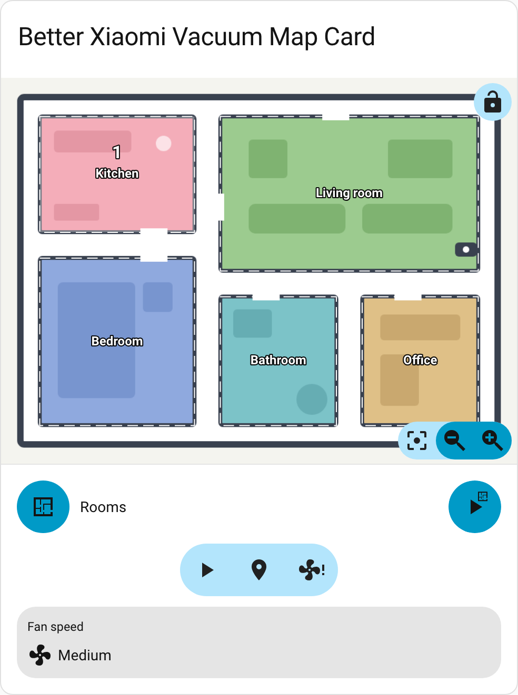

# Better Xiaomi Vacuum Map Card

Map-based cleaning controls for Home Assistant: live map, room and zone selections, and the tile and
icon controls around them.



The card element (`custom:xiaomi-vacuum-map-card`) and the release asset
(`xiaomi-vacuum-map-card.js`) keep their upstream names, so it is a drop-in replacement for
[the upstream card](https://github.com/PiotrMachowski/lovelace-xiaomi-vacuum-map-card): your YAML
does not change. Future plans are in [ROADMAP.md](ROADMAP.md).

Full option reference: [configuration](docs/configuration.md) · platforms:
[supported platforms](docs/platforms.md) · styling: [CSS variables](docs/css_variables.md)

## What this card does

The card draws a vacuum's map and turns taps into cleaning commands. Beyond the upstream feature
set, this build offers:

| Capability | Behaviour |
|---|---|
| Steady map refreshing | The snapshot reloads on a camera change or about once per five seconds, not on every vacuum, tile or icon update, and a hidden tab stops reloading. |
| Light registry traffic | One entity-registry call per vacuum, cached per device, instead of downloading the whole registry and fetching every entry. |
| Forgiving configuration | A missing room id, an incomplete calibration point or an invalid dynamic selection produces a validation message instead of breaking the card. |
| Reliable room editing | Generating rooms in the editor leaves the stored configuration untouched, affects only the card being edited, and repeated generation keeps a single rooms mode. |
| Readable tiles | Tile translations match regardless of case, labels use Home Assistant's entity naming, sensor durations follow the sensor's unit, and the return-to-base icon matches Home Assistant. |
| Cleaning order | A selected room shows its position in the cleaning order and the numbers renumber when rooms are deselected. |
| Safe after a re-map | Rooms that a new map removed are marked, named in a warning and left out of service calls, so a stale selection cannot clean the wrong room. |
| Starting view | `map_view` sets the view the map opens at, and the reset control or the `map_view.reset` action returns to it. |
| Horizontal layout | `layout: horizontal` puts the map beside the controls, and sections-view grid sizing makes the card resizable without `card-mod`. |
| Automatic room mapping | Room outlines, names and labels come from the camera's room metadata and the map colours; configured rooms remain the fallback. |
| Remembered view | Zoom, position and rotation persist per card, preset and map, and two-finger rotation is available. |
| Map appearance | Near-white map pixels can be made transparent for a dark dashboard, and room labels are white with a dark outline for contrast on any map colour. |
| Correct zooming | Zoom and rotation apply once to the image and its overlays, so room outlines stay on the map. |

## Install

Install version 1.0.0. The older `v2.x-igloczek` tags are pre-release snapshots of the same code
before the fork restarted its numbering, so a version updater may not offer 1.0.0; in that case
reinstall from the repository URL. Home Assistant 2026.11 blocks the HACS custom integration and
ships the built-in **Marketplace**; upgrading an existing HACS install migrates its entries and
resources.

### Marketplace (Home Assistant 2026.11+)

1. Open **Settings → Marketplace** and accept the first-run warning.
2. **Connect GitHub** when prompted; a custom repository cannot be added without an account.
3. Add `https://github.com/Igloczek/lovelace-better-xiaomi-vacuum-map-card` as a **Dashboard
   resource** and install it.
4. Marketplace registers the Lovelace resource itself; reload the browser.

### HACS (older Home Assistant)

1. Open HACS → **Frontend** → three-dot menu → **Custom repositories**.
2. Add `https://github.com/Igloczek/lovelace-better-xiaomi-vacuum-map-card` with category
   **Dashboard**.
3. Install **Better Xiaomi Vacuum Map Card**, then reload the browser.

The resource HACS adds points at
`/hacsfiles/lovelace-better-xiaomi-vacuum-map-card/xiaomi-vacuum-map-card.js`. Keep only one resource
entry: a second entry for the same file registers the element twice.

### Manual

1. Download `xiaomi-vacuum-map-card.js` from the
   [latest release](https://github.com/Igloczek/lovelace-better-xiaomi-vacuum-map-card/releases/latest).
2. Save it under `<ha config>/www/`, for example
   `/config/www/custom_lovelace/xiaomi-vacuum-map-card.js`.
3. Add it to [Lovelace resources](https://my.home-assistant.io/redirect/lovelace_resources/):
   ```yaml
   url: /local/custom_lovelace/xiaomi-vacuum-map-card.js
   type: module
   ```
4. Restart Home Assistant if you had to create `www`, then reload the browser.

### Re-adding the old repository

The repository was renamed from `Igloczek/lovelace-xiaomi-vacuum-map-card`. Remove the old custom
repository, add the new URL from the step above and reinstall; only the resource URL changes. GitHub
redirects the old repository URL, but do not rely on that for a cached entry.

## Migrating from upstream

Your YAML needs no edit and the element stays `custom:xiaomi-vacuum-map-card`, so only the resource
URL changes. Both builds register the same element and the first one wins, so load one build at a
time and keep the old file until your dashboard checks out.

A few behaviours differ from upstream with no YAML edit:

- `persist_map_view` defaults to `true`, so the card remembers zoom, position and rotation per card,
  preset and map. Set it to `false` for upstream behaviour.
- Two-finger rotation is on by default (`map_rotation_gesture`); set it to `false` for upstream
  zoom-and-pan-only gestures.
- The lock button's state is remembered with the view (`persist_map_lock`, default `true`) and takes
  precedence over `map_locked` after the first toggle.
- When the camera reports room metadata and the map has distinct room colours, detected outlines and
  labels replace configured room outlines; configured rooms remain the fallback.

## Quick start

A minimal card for a Xiaomi/Roborock vacuum with a map camera:

```yaml
type: custom:xiaomi-vacuum-map-card
entity: vacuum.roborock_s7
vacuum_platform: Xiaomi Miio
map_source:
  camera: camera.xiaomi_cloud_map_extractor
calibration_source:
  camera: true
map_modes:
  - template: vacuum_clean_zone
  - template: vacuum_goto
  - template: vacuum_clean_zone_predefined
    predefined_selections:
      - zones: [[25500, 25000, 26500, 26500]]
        label: {text: Kitchen, x: 26000, y: 25750}
```

Replace the entity ids and the platform. Every option, template and action is in
[configuration](docs/configuration.md); platform setup is in
[supported platforms](docs/platforms.md).

## Supported platforms

Xiaomi Miio, Roborock, Dreame, Valetudo, Viomi, Neato, Roomba, Wyze, Ecovacs, `send_command` and the
community integrations listed in [supported platforms](docs/platforms.md), where each page links its
templates, the entities the card discovers and the service calls it uses.

[Adding a new platform](CONTRIBUTING.md#adding-new-platform); platform templates are shared with
upstream, so those requests go to the
[upstream tracker](https://github.com/PiotrMachowski/lovelace-xiaomi-vacuum-map-card/issues/new?labels=new+platform&template=new_platform_request.yml).

## Reporting a problem

A screenshot rarely explains a map, room or tile bug: the card version, the vacuum integration, the
camera metadata and the console errors all matter. The repository includes a triage skill that
collects exactly that, locally and with your approval.

1. Tell your agent: **“Run the triage skill for this repository and prepare a report I can send.”**
2. Answer its questions, then review the redacted bundle. It does not upload anything, read secrets,
   or publish your map, room names or coordinates without asking.
3. Attach `triage-report.md`, `triage-data.json` and the attachments to the
   [triage report form](https://github.com/Igloczek/lovelace-better-xiaomi-vacuum-map-card/issues/new?template=triage_report.yml).

The same bundle can become a regression fixture, which is how device-specific gaps get covered
without the maintainer owning the same robot: attach the generated `fixture/` folder too. The full
guide, including a manual checklist for when you have no agent or no local access, is
[getting help with a card problem](docs/triage.md).

## Project

Planned work and the items waiting on hardware are in [ROADMAP.md](ROADMAP.md); released changes are
in [CHANGELOG.md](CHANGELOG.md); the differences from upstream are recorded in [FORK.md](FORK.md).

Bugs and feature requests for this fork belong on the
[fork tracker](https://github.com/Igloczek/lovelace-better-xiaomi-vacuum-map-card/issues); for a card
problem, start with [Reporting a problem](#reporting-a-problem). If the same configuration also fails
with the upstream release, report it upstream as well.

## Attribution and license

This fork is based on
[PiotrMachowski/lovelace-xiaomi-vacuum-map-card](https://github.com/PiotrMachowski/lovelace-xiaomi-vacuum-map-card),
created by Piotr Machowski; the card, its platform templates and its translations are his work and
the work of the upstream contributors. Special thanks to Bartosz Orczyk, Filip Schramm, Kamil
Dryzek and Marek Trochimiak for the design and development.

Released under the [MIT license](LICENSE).
