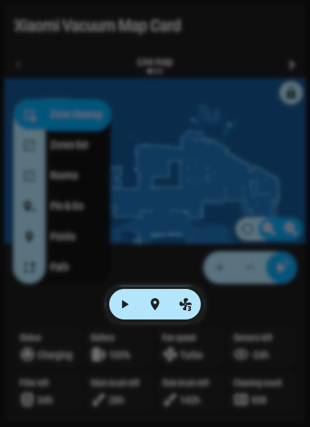
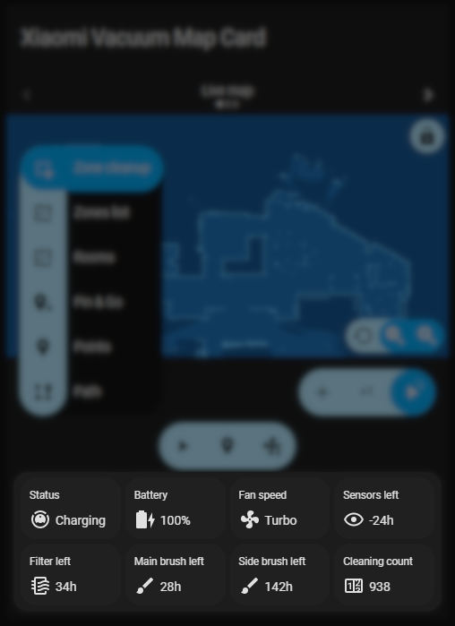
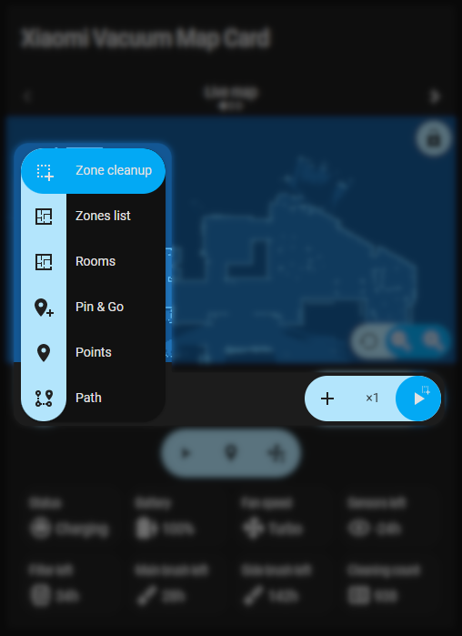

# Configuration

The configuration format is unchanged from the upstream card: no key was renamed and no option
was removed, so existing YAML keeps working. This fork adds these options on top:
[`layout`](#layout), [`map_view`](#map-view-options), `map_rotation`, `map_rotation_gesture`,
`persist_map_view`, `persist_map_lock`, `map_view_storage_key` and `transparent_background`.

The card has a visual editor for the basic options; everything else is YAML-only. The
[demo config](demo_config.yaml) is a complete example.

## Features

Features include:

- Map-based controls:
  - Zoned cleaning (manual and saved)
  - Going to target (manual and saved)
  - Room cleaning
  - Following path
  - Custom services
- Icon controls:
  - Conditional visibility
  - Customizable service calls
- Value tiles:
  - Customizable content
  - Conditional visibility
  - Customizable service calls
- General:
  - Multiple vacuums support
  - Multiple maps (camera/image) support
  - Fully customizable styling

## Main options

<table>
  <tr>
    <th>Key</th>
    <th>Type</th>
    <th>Required</th>
    <th>Default</th>
    <th>Description</th>
  </tr>
  <tr>
    <td><code>title</code></td>
    <td>string</td>
    <td>no</td>
    <td><i>empty</i></td>
    <td>Card's title</td>
  </tr>
  <tr>
    <td><code>layout</code></td>
    <td>string</td>
    <td>no</td>
    <td><code>vertical</code></td>
    <td>Arranges the map above the controls (<code>vertical</code>) or places the map and the mode, icon and tile controls side by side (<code>horizontal</code>). See <a href="#layout">layout</a></td>
  </tr>
  <tr>
    <td><code>language</code></td>
    <td>string</td>
    <td>no</td>
    <td><i>autodetected</i></td>
    <td>Overrides autodetected language (<a href="#translations">supported languages</a>)</td>
  </tr>
  <tr>
    <td><code>action_handler_id</code></td>
    <td>string</td>
    <td>no</td>
    <td>-</td>
    <td>Enables <a href="#action-handling">action handling</a></td>
  </tr>
  <tr>
    <td><code>additional_presets</code></td>
    <td>list</td>
    <td>no</td>
    <td><i>empty</i></td>
    <td>A list of additional <a href="#preset-options">presets</a> (e.g. with different map/vacuum)</td>
  </tr>
  <tr>
    <td><code>persist_map_view</code></td>
    <td>boolean</td>
    <td>no</td>
    <td><code>true</code></td>
    <td>Remembers zoom level and map position across page reloads, separately per card, per preset and per map id</td>
  </tr>
  <tr>
    <td><code>persist_map_lock</code></td>
    <td>boolean</td>
    <td>no</td>
    <td><code>true</code></td>
    <td>Remembers the state of the lock button together with the map view</td>
  </tr>
  <tr>
    <td><code>map_view_storage_key</code></td>
    <td>string</td>
    <td>no</td>
    <td><i>autogenerated</i></td>
    <td>Overrides the autogenerated storage key. The generated one includes the dashboard path, so the same card on two views keeps a view per view; set this to survive a dashboard rename, or to the same value on several cards to share one view between them. Cards that share a key also share their <code>map_view</code>, because a configured default is part of the generated key</td>
  </tr>
  <tr>
    <td><code>map_view</code></td>
    <td>object</td>
    <td>no</td>
    <td><i>neutral view</i></td>
    <td>View the map opens at when nothing is stored for it, and returns to when the map is reset. See <a href="#map-view-options">map view options</a></td>
  </tr>
  <tr>
    <td colspan="5" style="text-align: center">
      All values from <a href="#preset-options">preset options</a> section
    </td>
  </tr>
</table>

### Map view options

`map_view` is the card's starting view. A view stored by `persist_map_view` still wins over it; the
card uses the configured view only when nothing is stored for the current card, preset and map. The
map reset control (the centre-focus icon on the map) and the [`map_view.reset`](#action-handling)
action return to it.

The scale is applied around the centre of the map area, exactly like the zoom-in control, and `x`/`y`
are offsets from that centred view: `map_view: {scale: 2.5}` changes the zoom and keeps the map
centred at any card width, while `x: 40` moves it 40 layout pixels to the right of the centred
position. Rotation pivots on the same centre, so the offsets stay screen offsets at every angle.

| Key        | Type   | Required | Default        | Description                                                                                  |
|------------|--------|----------|----------------|----------------------------------------------------------------------------------------------|
| `scale`    | number | no       | `1`            | Zoom level, from `0.5` to `100` (`1` is the map fitted to the card)                          |
| `x`        | number | no       | `0`            | Horizontal offset in layout pixels from the centred view; `0` keeps the map horizontally centred |
| `y`        | number | no       | `0`            | Vertical offset in layout pixels from the centred view; `0` keeps the map vertically centred |
| `rotation` | number | no       | `map_rotation` | Angle in degrees the map opens at and returns to when reset                                  |

Every key is optional, and a key that is left out keeps its neutral value, so
`map_view: {scale: 2.5}` only changes the zoom. A value that is not a number, or a `scale` outside
`0.5`–`100` (the range the zoom controls offer), is reported as a configuration error instead of
being applied. The configured view applies to the whole card: each preset uses it where that preset
has no stored view. `map_view` is a main-configuration option only; a value inside
`additional_presets` is ignored. Unlike `persist_map_view`, which decides whether the user's view is
remembered, `map_view` also applies with `persist_map_view: false`.

The configured view is part of the stored view's lookup, so editing `map_view` starts from the new
default instead of keeping the view remembered for the old one.

```yaml
type: custom:xiaomi-vacuum-map-card
entity: vacuum.roborock_s7
map_source:
  camera: camera.vacuum_map
calibration_source:
  camera: true
vacuum_platform: Xiaomi Miio
map_view: # optional starting view; a stored view wins over it
  scale: 2.5
  x: 40
  y: -20
  rotation: 90
```

### Layout

`layout: horizontal` puts the map beside the modes, icons and tiles instead of above them. The
controls column scrolls inside the card when it is taller than the map, and the card never grows
wider than its container. The default `vertical` arrangement is unchanged. An unknown string is
reported as a configuration error so a typo does not silently fall back. The option is YAML-only
for now — the visual editor does not expose it.

```yaml
type: custom:xiaomi-vacuum-map-card
entity: vacuum.roborock_s7
map_source:
  camera: camera.vacuum_map
calibration_source:
  camera: true
vacuum_platform: Xiaomi Miio
layout: horizontal
```

In the sections view the card uses Home Assistant's default grid size for the vertical layout: 12
columns wide with `rows: "auto"`, so the cell fits the card's content as it always has. The
horizontal layout is a new arrangement and reports a numeric default height (6 rows) with
`min_columns: 9`, because at the permissive half-width minimum the controls column would leave the
map too narrow to use. It does not set `max_rows`, so a `grid_options: {rows: ...}` override can make
it as tall as you need. A sections-view cell shorter than the card's content scrolls the card rather
than shrinking the map. Prefer the horizontal layout for wide cells: at 320–400 px the map is only
about 140–220 px wide. Home Assistant's own
[`grid_options`](https://www.home-assistant.io/dashboards/sections/#resizing-cards) still override
these values per card.

## Preset options

| Key                        | Type    | Required        | Default         | Description                                                                                       |
|----------------------------|---------|-----------------|-----------------|---------------------------------------------------------------------------------------------------|
| `preset_name`              | string  | yes<sup>1</sup> | -               | Name of the preset                                                                                |
| `entity`                   | string  | yes             | -               | Vacuum entity                                                                                     |
| `map_source`               | string  | yes             | -               | Preset's [map source](#map-source-options)                                                        |
| `calibration_source`       | object  | yes<sup>2</sup> | -               | Preset's [calibration source](#calibration-source-options)                                        |
| `vacuum_platform`          | string  | no              | `default`       | Preset's [vacuum platform](platforms.md#supported-vacuum-platforms)                               |
| `map_locked`               | boolean | no              | `false`         | Default state of pan/zoom                                                                         |
| `two_finger_pan`           | string  | no              | `false`         | Enables two finger map panning                                                                    |
| `map_rotation`             | number  | no              | `0`             | Angle in degrees the map starts at, and returns to when the map is reset                          |
| `map_rotation_gesture`     | boolean | no              | `true`          | Enables rotating the map by twisting two fingers                                                  |
| `icons`                    | list    | no              | _autogenerated_ | Preset's [icons](#icon-list-entry-options)                                                        |
| `append_icons`             | boolean | no              | `false`         | Enables appending configured icons to autogenerated ones instead of replacing them                |
| `tiles`                    | list    | no              | _autogenerated_ | Preset's [tiles](#tile-list-entry-options)                                                        |
| `append_tiles`             | boolean | no              | `false`         | Enables appending configured tiles to autogenerated ones instead of replacing them                |
| `map_modes`                | list    | no              | _autogenerated_ | Preset's [map modes](#map-modes-options)                                                          |
| `activate`                 | object  | no              | -               | [Service call](#service-call-schema-options) that should be executed after clicking preset name   |
| `activate_on_switch`       | boolean | no              | `false`         | Enables executing `activate` service call after switching map preset                              |
| `conditions`               | list    | no              | -               | List of [conditions](#condition-options) that need to be (all of them) met for preset to be shown |
| `clean_selection_on_start` | boolean | no              | `true`          | Allows to disable cleaning selection on cleanup start                                             |
| `internal_variables`       | object  | no              | -               | Allows to specify default values for internal variables                                           |

<sup>1</sup> If multiple presets are configured

<sup>2</sup> Not mandatory when used with a platform that support a default calibration

## Map source options

| Key      | Type   | Required       | Default       | Description                                  |
|----------|--------|----------------|---------------|----------------------------------------------|
| `camera` | string | no<sup>1</sup> | -             | Entity id of map camera                      |
| `image`  | string | no<sup>1</sup> | -             | URL of map image                             |
| `crop`   | object | no             | _no cropping_ | Images [cropping options](#cropping-options) |
| `transparent_background` | boolean | no | `false` | Makes near-white map pixels transparent so the map blends into the card |

<sup>1</sup> Exactly one of `camera` or `image` must be provided

A static image works as a floorplan background: point `image` at any picture and add
`transparent_background: true` to blend near-white areas into the card. Drawing a live robot path on
top of a static image is not supported (upstream #503 / #922 overlap here); the camera source is the
supported way to get a live map with paths.

For `ROOM` selections, the card can use room IDs and names from the camera's `rooms` attribute, then trace each room's colored region from the map image. Manual room definitions remain available as a fallback when the camera does not provide room metadata or the map has no distinct room colors.

### Cropping options

| Key      | Type   | Required | Default | Description                                      |
|----------|--------|----------|---------|--------------------------------------------------|
| `top`    | number | no       | 0       | Image cropping value from the top (in pixels)    |
| `bottom` | number | no       | 0       | Image cropping value from the bottom (in pixels) |
| `left`   | number | no       | 0       | Image cropping value from the left (in pixels)   |
| `right`  | number | no       | 0       | Image cropping value from the right (in pixels)  |

## Calibration source options

| Key                  | Type    | Required       | Default | Description                                                                                                                                                                                      |
|----------------------|---------|----------------|---------|--------------------------------------------------------------------------------------------------------------------------------------------------------------------------------------------------|
| `camera`             | boolean | no<sup>1</sup> | -       | Enables retrieving calibration from camera defined in `map_source` ([Xiaomi Cloud Map Extractor](https://github.com/PiotrMachowski/Home-Assistant-custom-components-Xiaomi-Cloud-Map-Extractor)) |
| `entity`             | string  | no<sup>1</sup> | -       | Entity with calibration returned as a state                                                                                                                                                      |
| `attribute`          | string  | no             | -       | Enables usage of a configured attribute instead of state of given entity                                                                                                                         |
| `calibration_points` | list    | no<sup>1</sup> | -       | List of 3 or 4 [calibration points](#calibration-points-options)                                                                                                                                 |
| `identity`           | boolean | no<sup>1</sup> | -       | Enables using image coordinates on map (e.g. when map is used just for rooms)                                                                                                                    |
| `platform`           | string  | no<sup>1</sup> | -       | Enables using a default calibration from a chosen platform (provided that it supports it)                                                                                                        |

<sup>1</sup> Exactly one of `camera`, `entity`, `calibration_points`, `identity` or `platform` must be provided

### Calibration points options

Each of calibration points must have a following structure:

```yaml
vacuum: # coordinates of a point in a vacuum coordinate system
  x: 25500
  y: 25500
map: # coordinates of a point in a map coordinate system (can be read using e.g. Paint or Gimp)
  x: 466
  y: 1889
```

[Manual calibration guide](https://github.com/PiotrMachowski/lovelace-xiaomi-vacuum-map-card/wiki) (upstream wiki)

## Icon list entry options



| Key                 | Type    | Required | Default     | Description                                                                                                                                                               |
|---------------------|---------|----------|-------------|---------------------------------------------------------------------------------------------------------------------------------------------------------------------------|
| `icon`              | string  | yes      | -           | An icon to be displayed ([mdi](https://materialdesignicons.com/))                                                                                                         |
| `icon_id`           | string  | no       | -           | Icon ID that can be used to override the configuration                                                                                                                    |
| `tap_action`        | action  | no       | _more-info_ | [Action](https://www.home-assistant.io/lovelace/actions) that will be triggered when an icon is tapped. </br>**Warning:** use `service_data` instead of `data`            |
| `hold_action`       | action  | no       | -           | [Action](https://www.home-assistant.io/lovelace/actions) that will be triggered when an icon is held and released. </br>**Warning:** use `service_data` instead of `data` |
| `double_tap_action` | action  | no       | -           | [Action](https://www.home-assistant.io/lovelace/actions) that will be triggered when an icon is double-tapped. </br>**Warning:** use `service_data` instead of `data`     |
| `conditions`        | list    | no       | -           | List of [conditions](#condition-options) that need to be (all of them) met for an icon to be shown                                                                        |
| `tooltip`           | string  | no       | -           | Tooltip to be displayed on hoover                                                                                                                                         |
| `order`             | number  | no       | -           | Used to sort the icons                                                                                                                                                    |
| `replace_config`    | boolean | no       | `false`     | Marks that this icon should override the config of an already existing icon with the same `icon_id`                                                                       |
| `menu_id`           | string  | no       | -           | Adds this icon to the menu with given ID                                                                                                                                  |
| `label`             | string  | no       | -           | Label that should be displayed in the menu                                                                                                                                |
| `variables`         | object  | no       | -           | Variables that should be passed to to service calls                                                                                                                       |
| `remove`            | boolean | no       | `false`     | Allows to remove specific pre-defined icon (when combined with `icon_id` and `replace_config: true`                                                                       |

### Menu icon additional options

| Key                          | Type   | Required | Default | Description                                                                   |
|------------------------------|--------|----------|---------|-------------------------------------------------------------------------------|
| `type`                       | string | yes      | -       | Has to be set to `menu`                                                       |
| `menu_id`                    | string | yes      | -       | A menu ID                                                                     |
| `entity`                     | string | yes      | -       | Entity that should be used to generate the menu                               |
| `current_value_attribute`    | string | no       | -       | Changes the source of the selected value to given attribute                   |
| `available_values_attribute` | string | yes      | -       | Configures an attribute that contains all available values for the menu       |
| `icon_mapping`               | object | no       | -       | A mapping of possible entity value -> icon that should be used for the value  |
| `value_translation_keys`     | object | no       | -       | A mapping of possible entity value -> label that should be used for the value |
| `tap_action`                 | object | no       | -       | Action that should enable a specific value                                    |

Examples:
* Menu based on the `select` entity
  ```yaml
  type: "menu"
  menu_id: "water_box_mode"
  icon_id: "water_box_mode"
  entity: "select.water_box_mode"
  available_values_attribute: "options"
  icon: "mdi:water"
  icon_mapping:
      off: "mdi:water-remove"
      mild: "mdi:water-minus"
      moderate: "mdi:water"
      intense: "mdi:water-plus"
      custom: "mdi:water-sync"
  tap_action:
      action: "call-service"
      service: "select.select_option"
      service_data:
          option: "[[value]]"
          entity_id: "[[entity_id]]"
  ```

## Tile list entry options



| Key                 | Type    | Required | Default     | Description                                                                                                                                                              |
|---------------------|---------|----------|-------------|--------------------------------------------------------------------------------------------------------------------------------------------------------------------------|
| `label`             | string  | no       | -           | Label of a tile                                                                                                                                                          |
| `entity`            | string  | no       | -           | Entity which should be shown on a tile                                                                                                                                   |
| `internal_variable` | string  | no       | -           | Internal variable which should be shown on a tile                                                                                                                        |
| `icon`              | string  | no       | -           | An icon to be displayed ([mdi](https://materialdesignicons.com/))                                                                                                        |
| `icon_source`       | string  | no       | -           | Source of an icon, e.g: `vacuum.xiaomi.attributes.battery_icon`                                                                                                          |
| `attribute`         | string  | no       | -           | Attribute that should be shown on a tile                                                                                                                                 |
| `multiplier`        | number  | no       | -           | Multiplier that should be used to calculate value shown on a tile                                                                                                        |
| `precision`         | number  | no       | -           | Precision that should be used to present value on a tile                                                                                                                 |
| `unit`              | string  | no       | -           | Unit to be used                                                                                                                                                          |
| `tap_action`        | action  | no       | _more-info_ | [Action](https://www.home-assistant.io/lovelace/actions) that will be triggered when a tile is tapped. </br>**Warning:** use `service_data` instead of `data`            |
| `hold_action`       | action  | no       | -           | [Action](https://www.home-assistant.io/lovelace/actions) that will be triggered when a tile is held and released. </br>**Warning:** use `service_data` instead of `data` |
| `double_tap_action` | action  | no       | -           | [Action](https://www.home-assistant.io/lovelace/actions) that will be triggered when a tile is double-tapped. </br>**Warning:** use `service_data` instead of `data`     |
| `conditions`        | list    | no       | -           | List of [conditions](#condition-options) that need to be (all of them) met for a tile to be shown                                                                        |
| `tooltip`           | string  | no       | -           | Tooltip to be displayed on hoover                                                                                                                                        |
| `translations`      | map     | no       | -           | Translations that should be applied to tile's value                                                                                                                      |
| `tile_id`           | string  | no       | -           | ID of an autogenerated tile that should be replaced with this one                                                                                                        |
| `order`             | number  | no       | -           | Used to sort the tiles                                                                                                                                                   |
| `replace_config`    | boolean | no       | `false`     | Marks that this tile should override the config of an already existing tile with the same `tile_id`                                                                      |
| `variables`         | object  | no       | -           | Variables that should be passed to to service calls                                                                                                                      |
| `remove`            | boolean | no       | `false`     | Allows to remove specific pre-defined tile (when combined with `icon_id` and `replace_config: true`                                                                      |

## Condition options

| Key                 | Type   | Required       | Default | Description                                              |
|---------------------|--------|----------------|---------|----------------------------------------------------------|
| `entity`            | string | no             | -       | Entity ID                                                |
| `attribute`         | string | no             | -       | Attribute to use instead of entity state                 |
| `internal_variable` | string | no             | -       | Name of internal variable to use instead of entity state |
| `value`             | string | no<sup>1</sup> | -       | Entity state/attribute has to be equal to this value     |
| `value_not`         | string | no<sup>1</sup> | -       | Entity state/attribute has to be unequal to this value   |

<sup>1</sup> Exactly one of them has to be provided

## Map modes options



| Key                     | Type    | Required        | Default | Description                                                                          |
|-------------------------|---------|-----------------|---------|--------------------------------------------------------------------------------------|
| `template`              | string  | no<sup>1</sup>  | -       | Map mode template to be used ([supported templates](#supported-templates))           |
| `name`                  | string  | yes<sup>2</sup> | -       | Name of map mode                                                                     |
| `icon`                  | string  | yes<sup>2</sup> | -       | Icon of map mode ([mdi](https://materialdesignicons.com/))                           |
| `selection_type`        | string  | yes<sup>2</sup> | -       | Type of selection, one of [supported ones](#supported-selection-types)               |
| `service_call_schema`   | object  | yes<sup>2</sup> | -       | [Service call schema](#service-call-schema-options) that should be used in this mode |
| `run_immediately`       | boolean | no              | `false` | Enables calling service immediately after choosing a selection                       |
| `coordinates_rounding`  | boolean | no              | `true`  | Enables coordinates rounding                                                         |
| `max_selections`        | integer | no              | 1       | Maximal number of selections                                                         |
| `repeats_type`          | string  | no              | `NONE`  | Type of repeats inclusion, one of [supported ones](#supported-repeats-types)         |
| `max_repeats`           | integer | no              | 1       | Maximal value of repeats                                                             |
| `variables`             | object  | no              | -       | Variables that should be passed to `service_call_schema`                             |
| `predefined_selections` | list    | no<sup>3</sup>  | -       |                                                                                      |

> You can override any value from built-in template by providing it in your configuration

<sup>1</sup> Not required if all parameters with (<sup>2</sup>) are provided

<sup>2</sup> Required if `template` is not provided

<sup>3</sup> Required if `template` is not provided and `selection_type` is one
of: `PREDEFINED_RECTANGLE`, `PREDEFINED_POINT`. `ROOM` selections can be read automatically from the map camera's `rooms` attribute.

### Supported templates

List of supported templates depends on selected [`vacuum_platform`](platforms.md#supported-vacuum-platforms)

### Supported selection types

Following selection types are supported at this moment:

- `MANUAL_RECTANGLE`: Free-drawn rectangular zones on the map
  <details>
  <summary>Example video</summary>

  https://user-images.githubusercontent.com/6118709/141666913-d95f082d-f5bf-4ab5-a478-ba44effe6f34.mp4

  </details>
- `PREDEFINED_RECTANGLE`: Rectangular zones that can be selected on the map from `predefined_selections`
  <details>
  <summary>Example video</summary>

  https://user-images.githubusercontent.com/6118709/141666920-492a000c-9a78-4c20-b4f5-9343928140c7.mp4

  </details>
- `MANUAL_POINT`: Point selected by clicking in an arbitrary place on the map
  <details>
  <summary>Example video</summary>

  https://user-images.githubusercontent.com/6118709/141666921-2f3d66da-6ffc-492a-8439-625da97651bd.mp4

  </details>
- `PREDEFINED_POINT`: Point selected on the map from `predefined_selections`
  <details>
  <summary>Example video</summary>

  https://user-images.githubusercontent.com/6118709/141666923-965679e9-25fb-44cd-be08-fc63e5c85ce0.mp4

  </details>
- `ROOM`: Identifier-based selection. When the map camera exposes room metadata and the map uses distinct solid room colors, the card can detect each colored area, draw its outline, and use the room name from camera metadata. If color detection is unavailable, configured room selections are used.
  <details>
  <summary>Example video</summary>

  https://user-images.githubusercontent.com/6118709/141666925-34b01cde-82ff-447b-aecc-e9ced402b1ed.mp4

  </details>
- `MANUAL_PATH`: Path selected by clicking on the map
  <details>
  <summary>Example video</summary>

  https://user-images.githubusercontent.com/6118709/141666931-48d1717f-96d0-461d-84f4-788c071f3a78.mp4

  </details>

### Service call schema options

| Key                         | Type    | Required | Default | Description                                          |
|-----------------------------|---------|----------|---------|------------------------------------------------------|
| `service`                   | string  | yes      | -       | Service that should be called in a given mode        |
| `service_data`              | object  | no       | -       | Data that should be passed to service call           |
| `target`                    | object  | no       | -       | Target that should be passed to service call         |
| `evaluate_data_as_template` | boolean | no       | `false` | Enables support for jinja templates in service calls |  

It is possible to use several built-in placeholders in `service_data` section. They will be replaced by:

- `[[entity_id]]`: `entity_id` defined in preset's config
- `[[selection]]`: selection made on the map (zone, point or path)
- `[[selection_size]]`: number of selections made on the map
- `[[selection_unwrapped]]`: the same as `[[selection]]`, but passed as string unwrapped from brackets
- `[[repeats]]`: selected number of repeats
- `[[point_x]]`: x coordinate of selected point (for `MANUAL_POINT` and `PREDEFINED_POINT` selection types)
- `[[point_y]]`: y coordinate of selected point (for `MANUAL_POINT` and `PREDEFINED_POINT` selection types)
- `[[variables]]`: a list of variables for all selections

It is possible to use any value from `variables` section (wrapped with double rectangular brackets):

```yaml
variables:
  test_variable: 123
service_call_schema:
  service: fake.service
  service_data:
    var: "[[test_variable]]"
```

It is possible to use following modifiers in `service_data` section:

- `|[[jsonify]]`: if value ends with this modifier it will be decoded as a JSON and attached to service call in
  unwrapped form
- `|[[jsonify_jinja]]`: behaves in the same way as `|[[jsonify]]`, but is executed after jinja templating

### Supported repeats types

Following repeats types are supported at this moment:

- `NONE`: No repeats
- `INTERNAL`: Repeats number included in coordinates array (`[25500, 25000, 26500, 26500, 2]`)
- `EXTERNAL`: Repeats number used as a separate attribute in `service_call_schema`
- `REPEAT`: Repeats selection (repeats: `2`, selection: `[5,6]` => `[5,6,5,6]`)

### Predefined selection options

Format of data depends on selected `selection_type`:

* `PREDEFINED_RECTANGLE`

  | Key             | Type                    | Required | Default      | Description                                                                                                        |
  |-----------------|-------------------------|----------|--------------|--------------------------------------------------------------------------------------------------------------------|
  | `zones`         | list                    | yes      | -            | List of lists containing zone's coordinates in `[x,y,width,height]` format (e.g. `[[25500, 25000, 26500, 26500]]`) |
  | `icon`          | object                  | no       | -            | [Icon definition](#icon-options)                                                                                   |
  | `label`         | object                  | no       | -            | [Label definition](#label-options)                                                                                 |
  | `variables`     | object                  | no       | -            | Variables that should be passed to `service_call_schema`                                                           |
  | `default_state` | `selected`/`unselected` | no       | `unselected` | Default state of selection                                                                                         |
  | `state_entity`  | entity id               | no       | -            | Entity that should be used to store the state of selection                                                         |

  > See [this page](templates/setup.md#getting-coordinates) to check how to easily retrieve zone coordinates.

* `PREDEFINED_POINT`

  | Key             | Type                    | Required | Default      | Description                                                       |
  |-----------------|-------------------------|----------|--------------|-------------------------------------------------------------------|
  | `position`      | list                    | yes      | -            | Point's coordinates in `[x,y]` format (e.g. `[25500, 25000]`)     |
  | `icon`          | object                  | no       | -            | [Icon definition](#icon-options)                                  |
  | `label`         | object                  | no       | -            | [Label definition](#label-options)                                |
  | `variables`     | object                  | no       | -            | Variables that should be passed to `service_call_schema`          |
  | `default_state` | `selected`/`unselected` | no       | `unselected` | Default state of selection                                        |
  | `state_entity`  | entity id               | no       | -            | Entity that should be used to store the state of selection        |

  > See [this page](templates/setup.md#getting-coordinates) to check how to easily retrieve point coordinates.

* `ROOM`

 | Key             | Type                    | Required | Default      | Description                                                                                     |
 |-----------------|-------------------------|----------|--------------|-------------------------------------------------------------------------------------------------|
 | `id`            | string or number        | yes      | -            | Room's identifier                                                                               |
 | `outline`       | list                    | no       | -            | List of points forming an outline of a room (e.g. `[[25500,25500],[26500,25500],[25500,26500]]` |
 | `icon`          | object                  | no       | -            | [Icon definition](#icon-options)                                                                |
 | `label`         | object                  | no       | -            | [Label definition](#label-options)                                                              |
 | `variables`     | object                  | no       | -            | Variables that should be passed to `service_call_schema`                                        |
 | `default_state` | `selected`/`unselected` | no       | `unselected` | Default state of selection                                                                      |
 | `state_entity`  | entity id               | no       | -            | Entity that should be used to store the state of selection (e.g. `switch.bathroom`)             |

  > See [this page](templates/setup.md#getting-coordinates) to check how to easily create outline.

  `predefined_selections` may be omitted when the map camera provides a `rooms` attribute. The card will use the names and identifiers from that attribute and, when the image has distinct room fill colors, detect the room shapes and centers from the image.

### Icon options

| Key    | Type   | Required | Default | Description                                                       |
|--------|--------|----------|---------|-------------------------------------------------------------------|
| `name` | string | yes      | -       | An icon to be displayed ([mdi](https://materialdesignicons.com/)) |
| `x`    | number | yes      | -       | X coordinate of an icon (in vacuum's coordinate system)           |
| `y`    | number | yes      | -       | Y coordinate of an icon (in vacuum's coordinate system)           |

### Label options

| Key        | Type   | Required | Default | Description                                                       |
|------------|--------|----------|---------|-------------------------------------------------------------------|
| `text`     | string | yes      | -       | Text to be displayed                                              |
| `x`        | number | yes      | -       | X coordinate of a label (in vacuum's coordinate system)           |
| `y`        | number | yes      | -       | Y coordinate of a label (in vacuum's coordinate system)           |
| `offset_x` | number | no       | -       | Offset that should be applied to label in X direction (in pixels) |
| `offset_y` | number | no       | -       | Offset that should be applied to label in Y direction (in pixels) |

## Action handling

To enable handling actions you have to configure `action_handler_id` in [Main options](#main-options).
This card handles following actions:

- Starts cleaning
  ```yaml
    tap_action:
      action: fire-dom-event
      xiaomi_vacuum_map_card:
        action_handler_id: xiaomi_vacuum_map_card_id_1
        action: cleaning.start
  ```

- Set a value of internal variable
  ```yaml
    tap_action:
      action: fire-dom-event
      xiaomi_vacuum_map_card:
        action_handler_id: xiaomi_vacuum_map_card_id_1
        action: internal_variable.set
        data:
          variable: variable_1
          value: "some value"
  ```

- Selects next map mode
  ```yaml
    tap_action:
      action: fire-dom-event
      xiaomi_vacuum_map_card:
        action_handler_id: xiaomi_vacuum_map_card_id_1
        action: map_mode.next
  ```

- Selects previous map mode
  ```yaml
    tap_action:
      action: fire-dom-event
      xiaomi_vacuum_map_card:
        action_handler_id: xiaomi_vacuum_map_card_id_1
        action: map_mode.previous
  ```

- Selects a specific map mode
  ```yaml
    tap_action:
      action: fire-dom-event
      xiaomi_vacuum_map_card:
        action_handler_id: xiaomi_vacuum_map_card_id_1
        action: map_mode.set
        data:
          index: 2 
  ```

- Resets the map to its default view — the configured [`map_view`](#map-view-options), or the neutral
  view (scale `1`, no offset, `map_rotation`) when none is configured
  ```yaml
    tap_action:
      action: fire-dom-event
      xiaomi_vacuum_map_card:
        action_handler_id: xiaomi_vacuum_map_card_id_1
        action: map_view.reset
  ```

- Decrements a number of repeats
  ```yaml
    tap_action:
      action: fire-dom-event
      xiaomi_vacuum_map_card:
        action_handler_id: xiaomi_vacuum_map_card_id_1
        action: repeats.decrement
  ```

- Increments a number of repeats
  ```yaml
    tap_action:
      action: fire-dom-event
      xiaomi_vacuum_map_card:
        action_handler_id: xiaomi_vacuum_map_card_id_1
        action: repeats.increment
  ```

- Set a number of repeats
  ```yaml
    tap_action:
      action: fire-dom-event
      xiaomi_vacuum_map_card:
        action_handler_id: xiaomi_vacuum_map_card_id_1
        action: repeats.set
        data:
          value: 2
  ```

- Clears current selection
  ```yaml
    tap_action:
      action: fire-dom-event
      xiaomi_vacuum_map_card:
        action_handler_id: xiaomi_vacuum_map_card_id_1
        action: selection.clear
  ```

## FAQ

- **Make sure to check
  out the [upstream FAQ section in Discussions](https://github.com/PiotrMachowski/lovelace-xiaomi-vacuum-map-card/discussions/categories/faq),
  it contains a lot of useful information**

- **Does this card require rooted device?**

  No, it only utilizes features of Home Assistant.

- **How to create a map?**

  The easiest way is to
  use [Xiaomi Cloud Map Extractor](https://github.com/PiotrMachowski/Home-Assistant-custom-components-Xiaomi-Cloud-Map-Extractor),
  but you can use any image (e.g., a screenshot from Mi Home/FloleVac).

- **Can I use image that has a perspective distortion?**

  Yes, you just have to provide 4 calibration points.

## Migrating from v1.x.x

<details>
<summary>Configuration with <code>map_image</code></summary>
<table>
<tr>
<th>Old config (<code>v1.x.x</code>)</th><th>New config (<code>v2.x.x)</code></th>
</tr>
<tr>
<td>
<pre>
type: custom:xiaomi-vacuum-map-card
entity: vacuum.xiaomi_vacuum
map_image: '/local/custom_lovelace/xiaomi_vacuum_map_card/map.png'
calibration_points:
  - vacuum:
      x: 25500
      y: 25500
    map:
      x: 466
      y: 1889
  - vacuum:
      x: 26500
      y: 26500
    map:
      x: 730
      y: 1625
  - vacuum:
      x: 25500
      y: 26500
    map:
      x: 466
      y: 1625
zones:
  - [[25500, 25500, 26500, 26500]]
  - [[24245, 25190, 27495, 27940], [27492, 26789, 28942, 27889]]
</pre>
</td>
<td>
<pre>
type: custom:xiaomi-vacuum-map-card
entity: vacuum.xiaomi_vacuum
map_source:
  image: '/local/custom_lovelace/xiaomi_vacuum_map_card/map.png'
calibration_source:
  calibration_points:
    - vacuum:
        x: 25500
        y: 25500
      map:
        x: 466
        y: 1889
    - vacuum:
        x: 26500
        y: 26500
      map:
        x: 730
        y: 1625
    - vacuum:
        x: 25500
        y: 26500
      map:
        x: 466
        y: 1625
map_modes:
  - template: vacuum_clean_zone
  - template: vacuum_goto
  - template: vacuum_clean_zone_predefined
    predefined_selections:
      - zones: [[25500, 25500, 26500, 26500]]
      - zones: [[24245, 25190, 27495, 27940], [27492, 26789, 28942, 27889]]
</pre>
</td>
</tr>
</table>
</details>
<br/>
<details>
<summary>Configuration with <code>map_camera</code></summary>
<table>
<tr>
<th>Old config (<code>v1.x.x</code>)</th><th>New config (<code>v2.x.x)</code></th>
</tr>
<tr>
<td>
<pre>
type: custom:xiaomi-vacuum-map-card
entity: vacuum.xiaomi_vacuum
map_camera: camera.xiaomi_cloud_map_extractor
camera_calibration: true
zones:
  - [[25500, 25500, 26500, 26500]]
  - [[24245, 25190, 27495, 27940], [27492, 26789, 28942, 27889]]
</pre>
</td>
<td>
<pre>
type: custom:xiaomi-vacuum-map-card
entity: vacuum.xiaomi_vacuum
map_source:
  camera: camera.xiaomi_cloud_map_extractor
calibration_source:
  camera: true
map_modes:
  - template: vacuum_clean_zone
  - template: vacuum_goto
  - template: vacuum_clean_zone_predefined
    predefined_selections:
      - zones: [[25500, 25500, 26500, 26500]]
      - zones: [[24245, 25190, 27495, 27940], [27492, 26789, 28942, 27889]]
</pre>
</td>
</tr>
</table>
</details>

## Translations

Currently, this card contains translations for following languages:
* `bg` - Bulgarian (Български)
* `ca` - Catalan (Català)
* `cs` - Czech (Čeština)
* `da` - Danish (Dansk)
* `de` - German (Deutsch)
* `el` - Greek (Ελληνικά)
* `en` - English
* `es` - Spanish (Español)
* `fi` - Finnish (Suomi)
* `fr` - French (Français)
* `he` - Hebrew (עברית)
* `hu` - Hungarian (Magyar)
* `is` - Icelandic (Íslenska)
* `it` - Italian (Italiano)
* `lv` - Latvian (Latviešu)
* `nb-NO` - Norwegian Bokmål (Norsk bokmål)
* `nl` - Dutch (Nederlands)
* `pl` - Polish (Polski)
* `pt` - Portuguese (Português)
* `pt-BR` - Brazilian Portuguese (Português Brasileiro)
* `ro` - Romanian (Română)
* `ru` - Russian (Русский)
* `sk` - Slovak (Slovenčina)
* `sv` - Swedish (Svenska)
* `tr` - Turkish (Türkçe)
* `uk` - Ukrainian (Українська)
* `zh` - Chinese (中文)
* `zh-Hant` - Traditional Chinese (正體中文)

[Adding a new language](../CONTRIBUTING.md#adding-new-translations)
